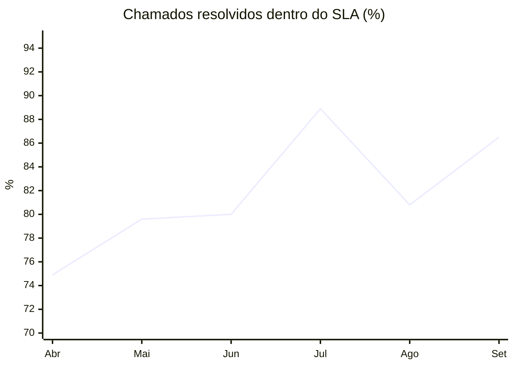

<h1 align="center">Alencar Buriti Jr.</h1>

  <b>Coordenador de Sistemas · Tech Lead · 12 anos em TI</b> 
  ERP, chão de fábrica, integrações e BI · Gestão de times com resultado medido 
  Goiânia-GO · Agronegócio · Ambiente multiempresa

  
  

---

### Sobre mim

São 12 anos em TI. Hoje, como **Coordenador de Sistemas e Tech Lead**, lidero equipes
multidisciplinares responsáveis por ERP (TOTVS Protheus), chão de fábrica, integrações e BI, com
foco em governança, arquitetura de sistemas e decisão baseada em dados.

Meu trabalho é traduzir a necessidade do negócio em solução que **reduz custo e risco
operacional**, e provar o resultado com número. Junto duas coisas que normalmente ficam separadas:
**desenvolver pessoas** e **resolver o problema difícil**. Defino prioridade com as áreas,
especifico antes de desenvolver, reviso e entro no diagnóstico quando o problema exige. Nada
chega em produção sem teste, rastreabilidade e mudança aprovada.

Os resultados abaixo foram medidos, não estimados.

> Tecnologia que não muda um indicador do negócio é custo. Meu critério de entrega é o processo
> da área funcionando melhor, não o fonte compilado.

---

### 🎧 Atendimento às áreas: SLA

  

| Indicador | Abr/2026 | Set/2026 | Leitura |
|---|:---:|:---:|---|
| Chamados resolvidos dentro do SLA | 74,9% | **86,5%** | **+11,6 p.p.** |
| Chamados abertos por mês | base | **+33%** (jul.) | A demanda cresceu, e o prazo melhorou mesmo assim |
| Chamados parados há mais de 30 dias (% da fila) | 25,8% | **19,0%** (jul.) | Fila mais nova, menos chamados esquecidos |

Medição feita na ferramenta de chamados desde abril de 2026, quando a coleta de indicadores começou. O SLA conta o horário comercial definido na própria ferramenta. Agosto caiu e setembro voltou a subir; a série está completa, sem meses escolhidos a dedo.

---

### 📈 O que mudou no time

Comparação entre o 1º trimestre de 2025 e o 3º trimestre de 2026, medida no histórico Git da área:

| Indicador | Variação | Leitura |
|---|:---:|---|
| Entregas vindas do time (commits, sem contar os meus) | **7x** | O time passou a entregar em volume |
| Novas funcionalidades entregues por trimestre | **8x** | Mais evolução e menos manutenção |
| Pessoas contribuindo no código | **4 → 12+** | Time e parceiros no mesmo fluxo |
| Correções emergenciais sobre o total de mudanças | **29% → 5%** | Menos incêndio, mais entrega planejada |
| Minha participação nos commits | **47% → 28%** | O time entrega sem depender de mim |
| Testes automatizados de interface | **0 → 50 casos** | Liberação com evidência, não com confiança |

Correções emergenciais e funcionalidades seguem o tipo informado em cada commit. A contagem de pessoas inclui parceiros externos.

---

### 🧩 Resultados entregues

| Desafio | Resultado |
|---|---|
| Rotina contábil crítica disputando recursos com o horário de operação | Tempo de processamento **−80%** e execução levada para fora do expediente |
| Concorrência no banco de dados em rotinas customizadas | Auditoria preventiva de toda a base customizada, com os padrões de risco corrigidos |
| Instabilidade em integração usada pela logística | Diagnóstico de capacidade que mostrou uma limitação de configuração, e não de infraestrutura |
| Publicação de versões em produção sem previsibilidade | Janelas definidas, um pacote por janela e responsável único por empresa |
| Mudança urgente de banco emissor de boletos | Operando no dia útil seguinte ao pedido |
| IA no desenvolvimento | Entrega por desenvolvedor **a partir de +25%**, descontada a sazonalidade |

---

### 🎯 Onde gero valor

<table>
<tr>
<td width="33%" valign="top">

**👥 Gestão de pessoas e portfólio**

- Rituais fixos: daily, 1:1 e acompanhamento com as áreas usuárias
- Portfólio de demandas priorizado por impacto (matriz GUT)
- Especificação aprovada pela área antes do código: escopo, critérios de aceite e indicador de sucesso
- Revisão de código como momento de ensino
- Indicadores de serviço (SLA, fila e recorrência) apresentados à liderança

</td>
<td width="33%" valign="top">

**⚙️ Entrega técnica**

- AdvPL/TLPP: MVC, REST, jobs, pontos de entrada e integrações
- Módulos de concessionária, peças e oficina (DMS)
- Financeiro: cobrança bancária, CNAB, aprovação por alçada e ativo fixo
- Rollout de customizações entre empresas
- Diagnóstico de desempenho em banco de dados e servidor de aplicação

</td>
<td width="33%" valign="top">

**🛡️ Governança e IA aplicada**

- Fluxo branch → PR → revisão → compilação → teste → GMUD
- Testes automatizados de interface (TIR / Python) como critério de liberação
- Agentes de IA por papel (especificação, desenvolvimento, revisão, build e QA), com o analista aprovando cada etapa
- Regras de segurança da informação e LGPD aplicadas à automação
- Observabilidade e monitoramento contínuo

</td>
</tr>
</table>

---

### 🔭 Em que estou focado agora

- **Regressão automatizada** em atualizações de versão do ERP
- **Estabilidade e observabilidade** do ambiente nas empresas do grupo
- **Controle de acesso centralizado**, com cadastro, auditoria e responsável por permissão
- **IA no ciclo de desenvolvimento**, da especificação ao teste
- **Primeira resposta dentro do SLA**, o próximo indicador de atendimento a melhorar

---

### 📊 Atividade

  
  

  

  

Quase todo o código fica em repositórios privados. Os gráficos mostram a contagem de contribuições, não o conteúdo.

---

### 🧭 Como eu trabalho

1. **Problema antes da solução.** Toda demanda começa com a dor da área medida e o indicador que vai provar o resultado.
2. **Especificar, depois codificar.** Spec, desenho e tarefas aprovados; código só depois.
3. **Ninguém sobe sozinho para produção.** Revisão, compilação, teste automatizado e GMUD, sempre nessa ordem.
4. **Diagnóstico com evidência.** Medir antes de mexer: log, plano de execução e linha do tempo, antes de qualquer opinião.
5. **Segurança e LGPD desde o início.** Na automação, no código e no dado.

---

### 🛠️ Stack

**ERP e linguagens** 

**Dados e infraestrutura** 

**Qualidade, governança e IA** 

-0A2240?style=flat-square)

**Gestão** 

